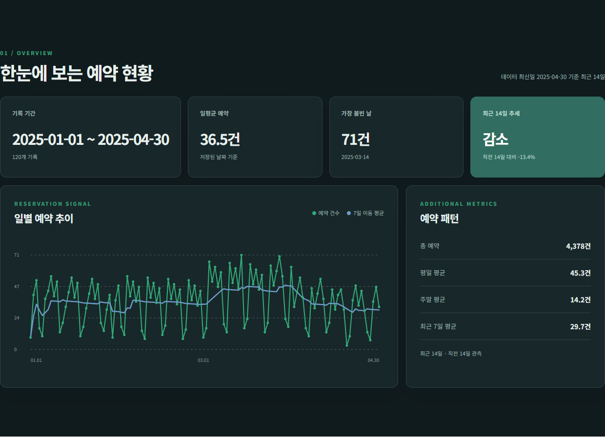
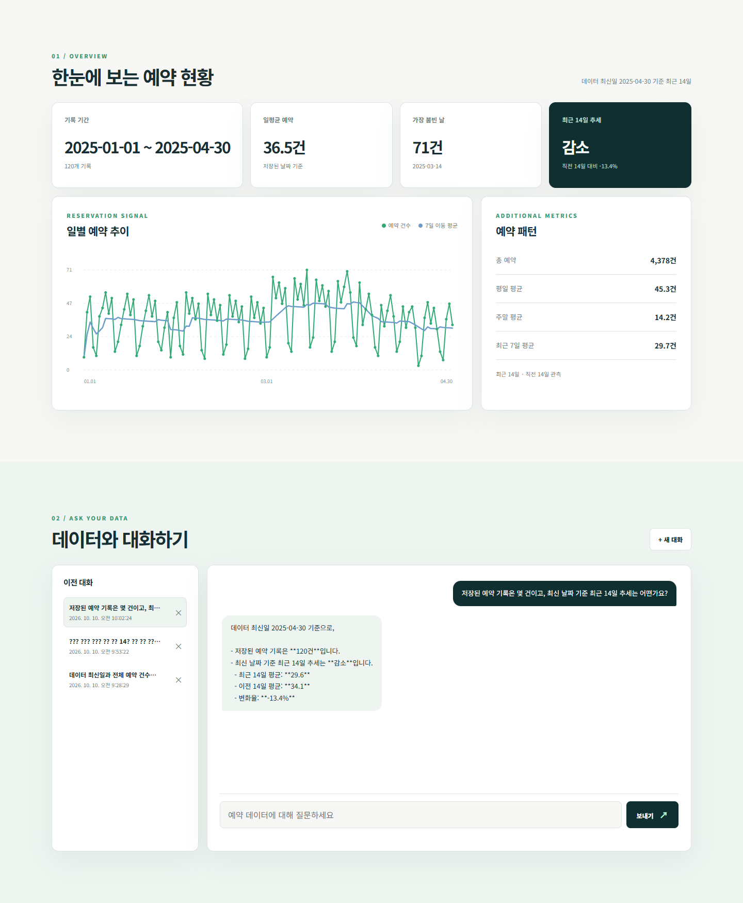
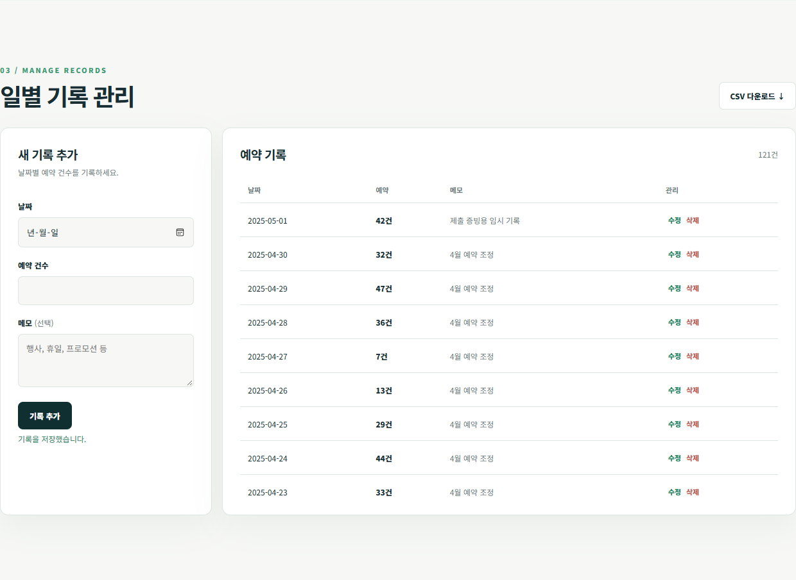
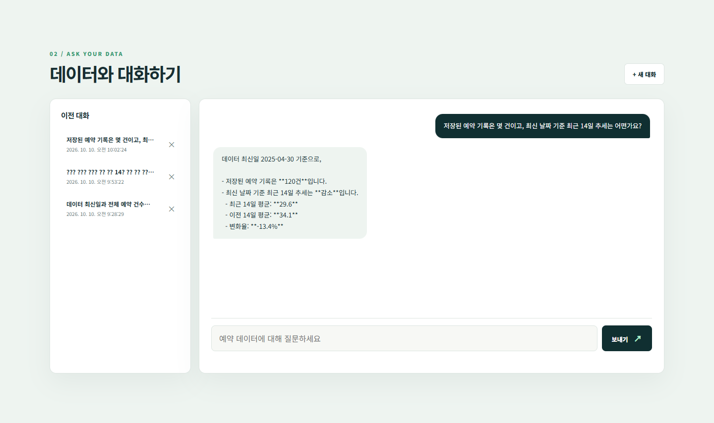

# SeatScope AI

가상 공유 오피스의 일별 좌석 예약 건수를 기록하고, Firestore에 저장된 데이터의 통계·추세를 근거로 AI에게 질문하는 공개 데모입니다. 실제 운영 정보나 개인정보를 입력하지 마세요. 배포된 일반 데이터·대화·채팅 API에는 인증이 없어 다른 방문자가 기록과 대화를 조회하거나 변경할 수 있습니다.

## 기술 스택

- 백엔드: Python 3.10+, FastAPI, Pydantic, Firebase Admin SDK / Firestore, OpenAI SDK(Codyssey Chat Completions 또는 OpenAI Responses API)
- 프론트엔드: 프레임워크 없는 HTML, CSS, JavaScript, SVG
- 배포 대상: Render(백엔드), Vercel(프론트엔드)

## 현재 상태와 배포 주소

2026-10-30 기준, 2026-07-01부터 2026-10-30까지의 일별 가상 예약 122건과 데모 대화 9개가 적재되어 있습니다. 이 중 8개 대화는 현재 통계를 바탕으로 구성한 예시이며 실제 AI 호출 기록은 아닙니다. Render·Vercel 배포 후 공개 API의 요약, 데이터 추가·수정·삭제, 대화 저장·조회·삭제, AI 답변 및 자동 저장을 확인했습니다. 아래 제출 스크린샷과 2026-10-10 실측 기록은 갱신 전 데이터를 사용한 과거 증빙입니다.

|항목|주소|
|---|---|
|프론트엔드|https://seatscope-ai.vercel.app|
|백엔드 API|https://seatscope-ai-api.onrender.com|
|Swagger UI|https://seatscope-ai-api.onrender.com/docs|

## 로컬 실행

저장소 루트에서 PowerShell을 열고 실행합니다.

```powershell
cd backend
python -m venv .venv
.\.venv\Scripts\Activate.ps1
pip install -r requirements.txt
Copy-Item .env.example .env # .env가 아직 없을 때만
```

`backend/.env`에 서버 환경 변수를 넣고 Firebase Firestore 데이터베이스를 생성합니다. 서비스 계정 키는 JSON 전체를 한 줄 값으로 넣거나 로컬 키 파일의 경로로 지정할 수 있습니다. 키 파일과 `.env`는 Git에 올리지 마세요.

```powershell
python seed_data.py
uvicorn main:app --reload
```

API는 `http://localhost:8000`, 문서는 `http://localhost:8000/docs`에서 확인합니다. 시드는 CSV의 모든 행을 날짜 고유성 트랜잭션으로 적재하며 이미 있는 날짜는 건너뜁니다. 수정된 기존 값을 초기 값으로 되돌리지는 않습니다. 초기 상태를 확인하려면 빈 Firestore 데이터셋에서 적재하세요. `python seed_example_conversations.py`는 현재 통계를 근거로 예시 대화 8개를 추가하며, 같은 기준일의 예시는 중복 생성하지 않습니다.

새 PowerShell 창에서 프론트엔드를 실행합니다.

```powershell
cd frontend
Copy-Item config.js.example config.js
python -m http.server 5500
```

`http://localhost:5500`에 접속합니다. `frontend/config.js`는 로컬 설정 파일이며 Git에서 제외됩니다.

### 환경 변수

|위치|이름|용도|
|---|---|---|
|백엔드|`OPENAI_API_KEY`|Codyssey의 `sk-cody-` 가상 키 또는 공식 OpenAI API 키|
|백엔드|`AI_PROVIDER`|`codyssey` 또는 `openai`; 생략하면 키 접두어로 판별|
|백엔드|`OPENAI_BASE_URL`|Codyssey에서 `https://copa.codyssey.kr/v1`; 공식 OpenAI 모드에서는 사용하지 않음|
|백엔드|`OPENAI_MODEL`|Codyssey 기본 `gpt-5.4-mini`, 공식 OpenAI 기본 `gpt-4.1-mini`|
|백엔드|`OPENAI_MAX_OUTPUT_TOKENS`|응답 토큰 상한, 기본 300|
|백엔드|`FIREBASE_SERVICE_ACCOUNT_JSON`|서비스 계정 JSON 문자열 또는 키 파일 경로|
|백엔드|`ALLOWED_ORIGINS`|쉼표로 구분한 허용 브라우저 Origin|
|백엔드|`ACTION_API_KEY`|GPT Actions 전용 Bearer 키|
|백엔드|`CHAT_DAILY_LIMIT`|배포 전체의 UTC 일일 AI 채팅 한도, 기본 30|
|프론트 빌드|`API_BASE_URL`|Render API의 공개 HTTPS 주소|

## Firestore 컬렉션 설계

|컬렉션|문서 ID와 주요 필드|목적·조회 방식|
|---|---|---|
|`data`|자동 ID; `date`, `value`, `memo`, `created_at`, `updated_at`|일별 예약 원본을 저장합니다. 목록과 요약 계산은 `date` 오름차순으로 읽습니다.|
|`data_dates`|날짜 문자열 `YYYY-MM-DD`; `data_id`|날짜당 기록을 하나로 제한하는 **고유성 인덱스 역할**입니다. Firestore 쿼리 성능을 위한 복합 인덱스가 아니라, 날짜를 문서 ID로 사용해 중복 생성을 막는 보조 컬렉션입니다. 일반 API 응답에는 포함하지 않습니다.|
|`conversations`|자동 ID; `title`, `messages[]`, `is_demo`, `created_at`, `updated_at`|한 대화의 메시지를 한 문서에 묶어 저장하므로 선택한 대화를 ID로 읽어 전체 메시지를 복원할 수 있습니다. 목록은 `updated_at` 내림차순으로 조회합니다. 각 메시지에는 `role`, `content`, `created_at`이 있으며 AI 답변에는 당시의 `analysis_summary`와 실행된 `tool_trace`도 남깁니다. `is_demo`는 외부 도구에서 조회 가능한 데모 대화를 구분합니다.|
|`chat_usage`|UTC 날짜 `YYYY-MM-DD`; `count`, `updated_at`|공개 데모 전체의 일일 AI 질문 횟수를 기록합니다.|

`data`의 자동 문서 ID만으로는 같은 날짜의 동시 생성 요청을 구분할 수 없습니다. 생성 트랜잭션은 먼저 `data_dates/{date}`의 존재 여부를 읽고, 비어 있으면 날짜 문서와 `data/{id}`를 함께 생성합니다. 날짜 문서가 있으면 409를 반환합니다. 날짜 변경 시에는 새 날짜 문서의 중복 여부를 읽은 뒤 **새 날짜 문서 생성 → 기존 날짜 문서 삭제 → 원본 기록 수정**을 한 트랜잭션으로 처리합니다. 기록 삭제도 원본과 날짜 문서를 한 트랜잭션에서 삭제합니다. 초기 데이터 적재 스크립트 역시 이 생성 함수를 사용하므로 같은 날짜를 다시 적재하지 않습니다.

채팅에서는 기존 `conversations/{id}` 문서를 트랜잭션에서 읽고 사용자 질문·AI 답변 두 메시지를 같은 문서에 함께 추가합니다. 새 대화라면 두 메시지가 담긴 문서를 생성합니다. 메시지는 최대 50개로 제한해 한 문서가 계속 커지는 것을 막습니다. AI 호출 전에는 `chat_usage/{UTC 날짜}`의 `count`를 트랜잭션에서 확인하고 1회 증가시켜 동시 요청에도 일일 한도를 적용합니다. 모델 호출이 실패해도 선점한 횟수는 복구하지 않습니다.

## API와 계산 기준

`POST/GET/PUT/DELETE /api/data`, `GET /api/data/summary`, `POST/GET /api/conversations`, `GET/DELETE /api/conversations/{id}`, `POST /api/chat`을 제공합니다. Swagger UI에서 요청·응답 모델을 확인할 수 있습니다.

요약의 “최근”은 오늘이 아니라 저장된 데이터의 최신 날짜를 기준으로 합니다. 최근 14일과 직전 14일의 실제 관측 일수 및 평균을 비교합니다. 각 구간에 7일 미만의 기록만 있으면 추세를 판정하지 않습니다. 브라우저 그래프는 실제 기록 날짜를 표시하고 날짜별 달력상 최근 7일 이동 평균을 함께 보여 줍니다.

체크인된 CSV를 계산한 예상값은 122건, 총 5,738건, 일평균 47.0건, 최고 2026-07-22의 80건, 최저 2026-07-04의 13건입니다. 데이터 최신일 2026-10-30 기준 최근 14일 평균은 50.6건, 직전 14일 평균은 49.7건이며 변화율은 +1.9%, 추세 분류는 유지입니다. Firestore 적재 후 실제 `/api/data/summary` 응답과 대조해야 합니다.

채팅 요청마다 요약을 한 번 계산하여 시스템 프롬프트와 `get_reservation_summary` 함수 도구에 공통으로 사용합니다. 사용한 요약 전체를 AI 답변의 `analysis_summary`에 저장하므로 나중에 데이터가 바뀌어도 답변의 당시 근거가 남습니다. `get_conversation` 함수 도구는 현재 선택한 대화만 읽습니다. 이전 문맥은 최근 20개 메시지만 모델에 보내며 저장 대화는 최대 50개 메시지입니다. 공개 데모의 AI 질문은 배포 전체에서 UTC 날짜당 30회로 제한합니다. 모델 호출 실패도 이미 선점한 1회에 포함됩니다.

## 보너스 기능

- 요약에 평일·주말 평균과 최근 7일 평균을 포함합니다.
- SVG 예약 그래프, CSV 다운로드, 브라우저에 저장되는 다크 모드를 제공합니다.
- 함수 도구 `get_reservation_summary`, `get_conversation`을 연결했습니다. Codyssey에서는 Chat Completions의 `tool_calls` → 서버 실행 → `role: tool` 메시지를, 공식 OpenAI에서는 Responses API의 `function_call_output`을 사용합니다. 실제로 실행된 도구 이름·인수·결과는 응답과 저장된 assistant 메시지의 `tool_trace`에 남습니다. 호출하지 않았다면 빈 배열입니다.
- 별도 `backend/mcp_server.py`에서 같은 Firestore 통계와 데모 대화 조회 기능을 MCP 도구로 제공합니다. `backend/verify_mcp.py`는 **별도 프로세스의 MCP 클라이언트**로 서버를 stdio 연결해 두 도구를 호출합니다. 이 방식을 외부 채널 연동으로 선택했습니다.
- `backend/actions/openapi.yaml`의 GPT Actions 명세도 실제 Render 주소로 설정했습니다. Actions는 선택하지 않은 대안이며, 별도 계정 연결과 `ACTION_API_KEY` 설정 없이는 활성화되지 않습니다.

### 도구 호출 흐름과 실측 근거

웹 AI 흐름: 질문 → 이번 요청의 데이터 요약을 시스템 프롬프트에 삽입 → 모델이 `get_reservation_summary` 호출 결정 → 서버가 같은 요약 스냅샷 반환 → 모델의 최종 답변 → 대화와 `tool_trace` 저장.

2026-10-10 로컬 서버 설정과 실제 AI 제공자를 사용해 질문 “get_reservation_summary 도구로 최신 통계를 확인한 뒤, 예약 기록 개수와 최근 14일 추세를 한 문장으로 알려줘.”를 실행했습니다. 질문이 현재 저장 데이터의 개수와 추세를 요구하므로 모델이 요약 도구를 선택했습니다. 실측 도구 이름은 `get_reservation_summary`, 인수는 `{}`, 결과는 `count=120`, `as_of_date=2025-04-30`, 최근·직전 14일 평균 `29.6`·`34.1`, 변화율 `-13.4%`였습니다. 최종 답변은 “데이터 최신일 2025-04-30 기준, 예약 기록은 120건이며 최근 14일 추세는 이전 14일 평균 34.1건에서 최근 14일 평균 29.6건으로 13.4% 감소했습니다.”였습니다. 실제 도구 실행 횟수는 1회입니다.

이 도구 호출은 로컬에서 실측했습니다. `tool_trace` 필드는 현재 Render 배포에도 반영되어 있으며, 공개 API에서 조회한 저장 대화의 assistant 메시지에 도구 이름·인수·결과가 기록된 것을 확인했습니다.

MCP 외부 클라이언트 흐름: 별도 클라이언트 프로세스 → stdio MCP 서버 → Firestore 요약·데모 대화 조회 → MCP 결과를 클라이언트에 반환. 아래 명령으로 재현합니다. MCP SDK는 웹 배포에 필요하지 않아 별도 요구 파일에 둡니다.

```powershell
cd backend
pip install -r mcp-requirements.txt
python seed_demo_conversations.py
python verify_mcp.py --conversation-id '위 명령에서 출력된 데모 대화 ID'
```

실측 MCP 클라이언트는 `get_reservation_summary({})`에서 기간 `2025-01-01 ~ 2025-04-30`, 120건, 총 4,378건, 감소 `-13.4%`를 받았습니다. 이어 `get_conversation({"conversation_id":"zSzGxieVTZFYsxpKA8Gh"})`에서 “가상 예약 추세 상담”의 사용자·AI 메시지 2개를 받았습니다. MCP 도구는 읽기 전용이며 대화 조회는 `is_demo=true`인 기록으로 제한합니다.

시각화·내보내기·다크 모드도 배포된 브라우저에서 확인했습니다. 예약 추이와 추가 통계는 아래 채팅 화면 및 다크 모드 이미지에 보입니다. CSV 다운로드 파일 `seatscope-reservations.csv`는 `date,value,memo` 헤더와 데이터 120행(총 121행)을 포함했습니다.



## 배포

1. GitHub 저장소를 Render Web Service에 연결하고 Root Directory를 `backend`로 설정합니다. Build Command는 `pip install -r requirements.txt`, Start Command는 `uvicorn main:app --host 0.0.0.0 --port $PORT`입니다. 위 백엔드 환경 변수를 Render에 설정합니다.
2. 배포된 `/docs`에서 API를 확인하고 빈 Firestore 데이터셋에 `python seed_data.py`를 한 번 실행합니다. 로컬에서 동일한 서비스 계정으로 시드를 실행해도 됩니다.
3. GitHub 저장소를 Vercel에 연결하고 Root Directory를 `frontend`, Build Command를 `node build.mjs`, Output Directory를 `dist`로 설정합니다. `API_BASE_URL`에 Render HTTPS 주소를 넣습니다.
4. Vercel의 정확한 Origin을 Render `ALLOWED_ORIGINS`에 추가하고 재배포합니다. 브라우저에서 채팅·CRUD·대화 불러오기를 검증합니다.

## 검증 및 제출 증빙

로컬에서 `python -m unittest discover -s tests`(백엔드 디렉터리 기준)와 `node --check frontend/app.js`, `node --check frontend/build.mjs`로 순수 계산과 문법을 확인할 수 있습니다. 배포된 `/docs`와 프론트엔드 정적 파일은 200 응답을 확인했습니다. 공개 API에서 임시 데이터의 추가·수정·삭제 후 요약이 다시 120건인 것을 확인했고, 임시 대화의 저장·조회·삭제도 확인했습니다. 실제 `POST /api/chat`은 200 응답을 받았고, 생성된 두 메시지와 당시 120건 요약이 Firestore 대화에 저장됐습니다.

2026-10-10에 배포된 브라우저 화면에서 임시 기록(2025-05-01, 42건)을 추가해 목록 반영을 촬영한 뒤 삭제했습니다. 이후 목록과 요약이 원래 120건으로 돌아온 것을 확인했습니다. 새 질문에 대한 AI 답변을 확인하고, 새 대화를 연 다음 이전 대화를 선택해 메시지가 복원되는 장면을 촬영했습니다.

- [x] 데이터 요약이 보이는 채팅 화면: 질문과 실제 AI 답변
- [x] 데이터 관리 화면: 기록 추가 후 목록에 표시된 결과
- [x] 대화 기록 화면: 이전 대화를 선택해 메시지 복원
- [x] 보너스: 웹 함수 호출과 MCP 외부 클라이언트 호출의 실제 근거 기록

### 1. 데이터 요약과 AI 채팅



### 2. 데이터 관리



### 3. 대화 기록 불러오기



답변은 저장 데이터의 120건, 최신 날짜 2025-04-30, 최근 14일 평균 29.6건, 직전 14일 평균 34.1건, 변화율 -13.4%와 일치합니다.
